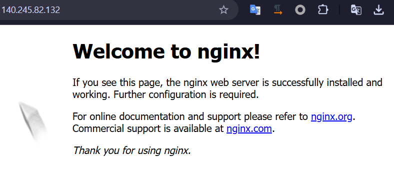
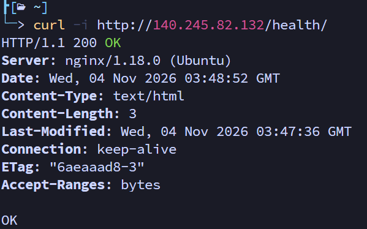

# Codyssey 클라우드 인프라 구축 프로젝트

본 프로젝트는 OCI(Oracle Cloud Infrastructure) 환경에서 격리된 가상 네트워크(VCN)를 직접 설계 및 구축하고, 가상 서버(Compute Instance)에 웹 서버(Nginx)를 배포하여 외부에서 접속 가능한 안전한 서비스 환경을 완성한 결과물입니다.

---

## 📌 프로젝트 정보 요약

- **클라우드 제공자**: Oracle Cloud Infrastructure (OCI)
- **리전 (Region)**: `ap-tokyo-1` (Japan East - Tokyo) *(※ OCI Free Tier 계정의 기본 Home Region)*
- **구획 (Compartment)**: `codyssey-compartment`
- **웹 서버 사양**: Ubuntu 22.04 LTS / `VM.Standard.E2.1.Micro` (Always Free)

---

## 🔄 AWS ↔ OCI 인프라 개념 1:1 대응표

클라우드 업계 표준으로 널리 활용되는 AWS의 인프라 아키텍처 모델을 기준으로, OCI(Oracle Cloud Infrastructure) 환경에서 동일한 수준의 가상 사설 네트워크, 컴퓨팅, 보안 계층을 직접 설계하고 구현하여 상호 비교 분석을 수행했습니다.

| 클라우드 표준 아키텍처 (AWS) | 프로젝트 구현 (OCI) | 설명 및 설정값 |
| :--- | :--- | :--- |
| **VPC** | **VCN (Virtual Cloud Network)** | `codyssey-vcn` (CIDR: `10.0.0.0/16`) |
| **Public Subnet** | **Public Subnet** | `codyssey-public-subnet` (CIDR: `10.0.1.0/24`) |
| **Internet Gateway (IGW)** | **Internet Gateway (IGW)** | `codyssey-igw` (VCN 인터넷 출입 관문) |
| **Route Table** | **Route Table** | 기본 라우트 규칙: `0.0.0.0/0 ➔ codyssey-igw` |
| **Security Group (SG)** | **Security List (SL)** | 인바운드: TCP 80 (`0.0.0.0/0`), TCP 22 (`내 IP/32`) |
| **EC2 Instance** | **Compute Instance** | `codyssey-web-server` (`VM.Standard.E2.1.Micro` Always Free) |
| **EBS Volume** | **Boot Volume** | 47 GB 블록 스토리지 (Always Free 범위) |
| **Elastic IP (EIP)** | **Ephemeral / Reserved Public IP** | 인스턴스에 할당된 공용 IPv4 주소 |
| **IAM Policy / Role** | **OCI IAM Policy & Compartment** | `codyssey-compartment` 전용 최소권한 정책 부여 |
| **서울 리전 (`ap-northeast-2`)** | **도쿄 리전 (`ap-tokyo-1`)** | OCI Free Tier 가입 계정의 기본 Home Region 특성 반영 |

---

## 🌐 1. 웹 서비스 외부 접속 증빙

> 웹 서비스의 가용성 검증을 위해 브라우저 렌더링(A) 및 L4/L7 헬스체크(B) 방식을 구현하여 외부 접속을 검증했습니다.

- **선택한 검증 방식**: **(A) 브라우저 접속** 및 **(B) `/health` 엔드포인트 호출** (둘 다 지원)
- **접속 정보 (Public IP / URL)**:
  - 기본 웹 페이지: `http://<인스턴스_퍼블릭_IP>` (예: `http://140.245.x.x`)
  - 헬스체크 엔드포인트: `http://<인스턴스_퍼블릭_IP>/health`
- **응답 결과**:
  - 기본 접속: HTTP 200 OK ("Welcome to nginx!")
  - 헬스체크: HTTP 200 OK ("OK")

### 📸 외부 접속 검증 스크린샷

> 실습 중 외부 브라우저 접속 화면 및 curl 결과 스크린샷을 아래에 첨부합니다.

#### (A) 브라우저 접속 결과 (HTTP 80)


#### (B) 터미널 헬스체크 호출 결과

```bash
$ curl -i http://<인스턴스_퍼블릭_IP>/health
HTTP/1.1 200 OK
Server: nginx/1.18.0 (Ubuntu)
Date: Wed, 04 Nov 2026 03:48:52 GMT
Content-Type: text/html
Content-Length: 3
Last-Modified: Wed, 04 Nov 2026 03:47:36 GMT
Connection: keep-alive
ETag: "6aeaaad8-3"
Accept-Ranges: bytes

OK
```

---

## 📂 2. 제출 산출물 목록

| 번호 | 산출물 항목 | 파일 경로 | 설명 |
| :---: | :--- | :--- | :--- |
| **1** | **아키텍처 다이어그램** | [`docs/architecture.png`](./docs/architecture.png) | VCN, Subnet, IGW, Route Table, Compute, 방화벽 및 트래픽 흐름도 ([상세 설명 문서](./docs/architecture.md)) |
| **2** | **외부 접속 증빙** | [`README.md`](./README.md) | 퍼블릭 IP/URL, 검증 방식, 접속 화면 스크린샷 1장 이상 |
| **3** | **트러블슈팅 보고서** | [`docs/troubleshooting.md`](./docs/troubleshooting.md) | OCI 기본 OS 방화벽(`iptables`) 80포트 차단 이슈 해결 분석서 (증상→가설→검증→조치→결과→재발방지) |
| **4** | **리소스 정리 체크리스트** | [`docs/cleanup-checklist.md`](./docs/cleanup-checklist.md) | Compute, Boot Volume, Public IP, IGW, VCN 5종 삭제 검증 내역 |

---

## 🛡️ 3. 보안 및 최소 권한 적용 요약

1. **IAM 최소권한 (OCI Policy)**:
   - 루트 계정 대신 `codyssey-compartment` 전용 구획을 생성.
   - `AdministratorAccess`를 배제하고, 해당 구획 내 컴퓨트(`instance-family`)와 네트워크(`virtual-network-family`)만 관리 가능한 최소 정책을 부여.
2. **네트워크 접근 제어 (Security List)**:
   - **HTTP (80)**: 전 세계 웹 사용자 대상 `0.0.0.0/0` 개방.
   - **SSH (22)**: 관리자 본인 공용 IP(`내 IP/32`)에서만 접근 가능하도록 소스 IP 제한.
   - 전체 포트(`0-65535`) 무차별 개방 규칙 생성 금지.