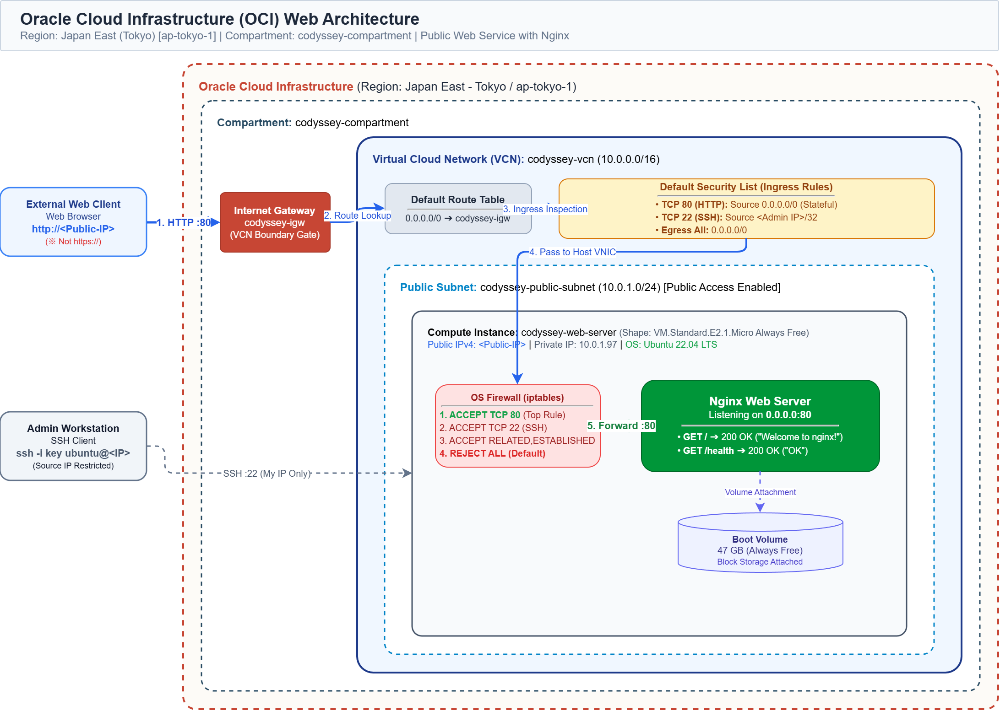
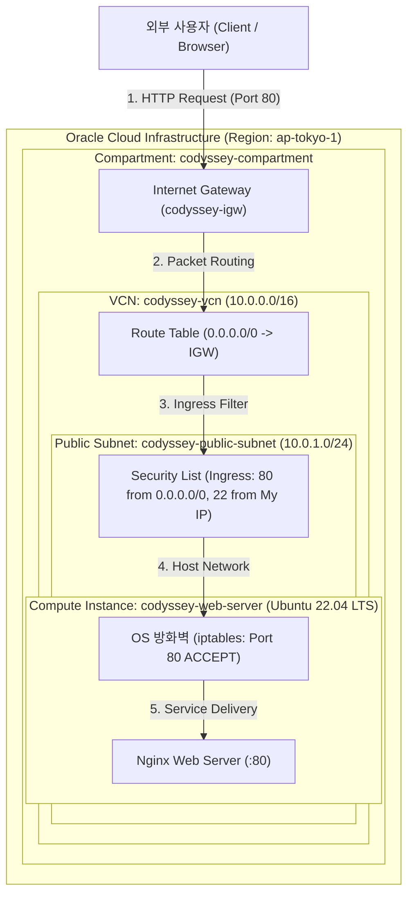

# 인프라 아키텍처 다이어그램 (Architecture Diagram)

본 문서는 OCI 환경에 구축된 웹 서비스 인프라 구성과 외부 트래픽 흐름을 시각화한 아키텍처 설명서입니다.

> 📁 **최종 제출 규격 파일**: `docs/architecture.png` (또는 `docs/architecture.pdf`)

---

## 📌 아키텍처 다이어그램



---

## 📐 아키텍처 구조 (Mermaid 다이어그램)



---

## 📊 ASCII 스케치 다이어그램

```text
========================================================================================
                          Oracle Cloud Infrastructure (ap-tokyo-1)
                     Compartment: codyssey-compartment
========================================================================================

    [ Internet (External Clients) ]
                   │
                   ▼ (HTTP Port 80 / SSH Port 22)
    ┌─────────────────────────────┐
    │   Internet Gateway (IGW)    │
    └──────────────┬──────────────┘
                   │
                   ▼ (0.0.0.0/0 Route)
    ┌──────────────────────────────────────────────────────────────────────────┐
    │  VCN: codyssey-vcn (10.0.0.0/16)                                         │
    │                                                                          │
    │  ┌────────────────────────────────────────────────────────────────────┐  │
    │  │  Public Subnet: codyssey-public-subnet (10.0.1.0/24)               │  │
    │  │                                                                    │  │
    │  │  [ Security List / NSG ]                                           │  │
    │  │  - Ingress: TCP 80  <- 0.0.0.0/0                                   │  │
    │  │  - Ingress: TCP 22  <- <내 IP>/32                                 │  │
    │  │  - Egress:  All     -> 0.0.0.0/0                                   │  │
    │  │                                                                    │  │
    │  │  ┌──────────────────────────────────────────────────────────────┐  │  │
    │  │  │  Compute Instance: codyssey-web-server                       │  │  │
    │  │  │  Shape: VM.Standard.E2.1.Micro                               │  │  │
    │  │  │  Public IP: x.x.x.x  /  Private IP: 10.0.1.x                │  │  │
    │  │  │                                                              │  │  │
    │  │  │   ┌──────────────────────────────────────────────────────┐   │  │  │
    │  │  │   │  OS 방화벽 (iptables / ufw)                          │   │  │  │
    │  │  │   │  - Port 80: ACCEPT                                   │   │  │  │
    │  │  │   │  - Port 22: ACCEPT                                   │   │  │  │
    │  │  │   │                                                      │   │  │  │
    │  │  │   │   ┌──────────────────────────────────────────────┐   │   │  │  │
    │  │  │   │   │  Nginx Web Server (Listening on :80)         │   │   │  │  │
    │  │  │   │   │  - GET /        -> 200 OK (Welcome Page)     │   │   │  │  │
    │  │  │   │   │  - GET /health  -> 200 OK ("OK")             │   │   │  │  │
    │  │  │   │   └──────────────────────────────────────────────┘   │   │  │  │
    │  │  │   └──────────────────────────────────────────────────────┘   │  │  │
    │  │  │                                                              │  │  │
    │  │  │  Boot Volume: 47 GB                                          │  │  │
    │  │  └──────────────────────────────────────────────────────────────┘  │  │
    │  └────────────────────────────────────────────────────────────────────┘  │
    └──────────────────────────────────────────────────────────────────────────┘
```

---

## 🔄 외부 → 웹 서버 트래픽 흐름 단계별 설명

1. **외부 클라이언트 요청**:
   - 웹 브라우저에서 `http://<인스턴스_공용_IP>` (TCP 80)로 접속 요청을 전송합니다.
2. **Internet Gateway 도달**:
   - VCN의 외부 관문인 Internet Gateway(`codyssey-igw`)를 통해 패킷이 VCN 경계 내부로 인입됩니다.
3. **Route Table 확인**:
   - Public Subnet에 연결된 라우팅 테이블이 패킷의 수신/송신 경로를 관리합니다.
4. **Security List 인바운드 검사**:
   - 서브넷 레벨의 Security List가 수신지 포트 80과 소스 IP(`0.0.0.0/0`)를 대조하여 트래픽을 허용(Pass)합니다.
5. **Compute 인스턴스 도달 및 OS 방화벽 통과**:
   - 인스턴스 가상 NIC(VNIC)에 도달한 후, Ubuntu 커널의 `iptables` 규칙을 거쳐 80 포트가 최종 허용됩니다.
6. **Nginx 웹 서버 응답**:
   - 80번 포트를 리스닝 중인 Nginx 데몬이 요청을 수신하여 200 OK 및 웹 콘텐츠를 클라이언트에게 역순으로 반환합니다.
