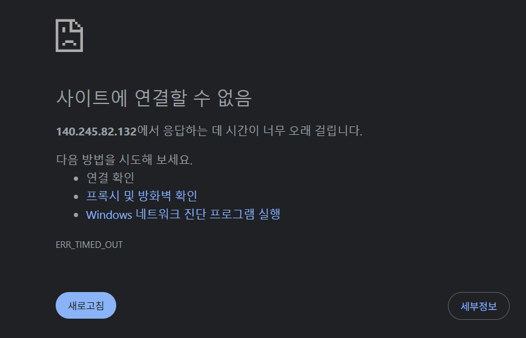

# 트러블슈팅 보고서 (Troubleshooting Report)

본 문서는 OCI 기반 클라우드 인프라 구축 및 Nginx 웹 서비스 배포 과정에서 발생한 실제 통신 장애를 분석하고 해결한 과정을 기록한 보고서입니다.

---

## 📌 문제 해결 요약

| 사례 번호 | 문제 상황 | 원인 | 해결 조치 | 결과 |
| :---: | :--- | :--- | :--- | :---: |
| **사례 1** | OCI Security List 80 포트 개방 후에도 외부 접속 불가 | `iptables` 규칙 순서 오류로 인해 5번 라인의 `REJECT all` 뒤에 80 허용 규칙이 위치하여 차단됨 | 최상단(1번 라인)에 `ACCEPT :80` 규칙 삽입 및 `netfilter-persistent`로 영구 저장 | 해결 완료 |
| **사례 2** | 방화벽 수정 후에도 브라우저에서 타임아웃 발생 | 최신 웹 브라우저(Chrome/Edge)가 `http://` 대신 `https://` (443 포트)로 자동 전환하여 요청 전송 | `tcpdump` 패킷 분석을 통해 인바운드 미도달 규명 후, 브라우저 주소창에 명시적으로 `http://` 지정 | 해결 완료 |

---

## 🔍 [사례 1] iptables 규칙 평가 순서에 의한 80 포트 차단 문제

### 1. 증상 (Symptom)
- OCI VCN의 Security List에 Ingress TCP 80 (`0.0.0.0/0`)을 정상 추가함.
- 인스턴스 내부에서는 `curl http://localhost` 실행 시 200 OK 응답이 정상 반환됨.
- 그러나 외부 로컬 컴퓨터 브라우저에서 접속 시도시 연결 시간 초과(Connection Timed Out) 발생.


### 2. 가설 (Hypothesis)
- **가설 1**: Security List 또는 Route Table 설정 오류로 OCI 네트워크 경계에서 드롭됨.
- **가설 2**: OCI 우분투 이미지 기본 `iptables` 규칙에 의해 OS 레벨에서 차단되고 있음.

### 3. 검증 (Verification)
- `sudo iptables -L -v -n` 명령어로 규칙 및 패킷 카운터 확인:
  ```text
  Chain INPUT (policy ACCEPT 0 packets, 0 bytes)
   pkts bytes target     prot opt in     out     source               destination         
  15081   53M ACCEPT     all  --  *      *       0.0.0.0/0            0.0.0.0/0            state RELATED,ESTABLISHED
      0     0 ACCEPT     icmp --  *      *       0.0.0.0/0            0.0.0.0/0           
    114 10482 ACCEPT     all  --  lo     *       0.0.0.0/0            0.0.0.0/0           
      1    52 ACCEPT     tcp  --  *      *       0.0.0.0/0            0.0.0.0/0            state NEW tcp dpt:22
     29  2108 REJECT     all  --  *      *       0.0.0.0/0            0.0.0.0/0            reject-with icmp-host-prohibited
      0     0 ACCEPT     tcp  --  *      *       0.0.0.0/0            0.0.0.0/0            state NEW tcp dpt:80
  ```
- **발견된 문제**:
  - `iptables`는 **위에서부터 순차 평가(First-match)** 원칙을 따름.
  - 5번 라인에 `REJECT all`이 위치하고, 80번 포트 허용 규칙(`ACCEPT tcp dpt:80`)은 **6번 라인**에 삽입되어 있었음.
  - 이로 인해 외부에서 유입된 80번 포트 패킷이 6번 라인에 도달하기 전 5번 라인의 `REJECT all`에 걸려 차단됨 (실제 29개의 차단 패킷 카운트 확인).

### 4. 조치 (Remediation)
- 80번 포트 허용 규칙을 모든 거부 규칙보다 앞선 **최상단(1번 라인)**에 삽입:
  ```bash
  sudo iptables -I INPUT 1 -p tcp --dport 80 -j ACCEPT
  sudo netfilter-persistent save
  ```
- `sudo iptables -L INPUT -n --line-numbers`로 1번 라인에 `ACCEPT tcp dpt:80`이 최우선 적용된 것 확인.

---

## 🔍 [사례 2] 브라우저의 HTTPS 자동 전환 및 tcpdump 계층 분석

### 1. 증상 (Symptom)
- `iptables` 1번 라인에 80 포트를 개방했음에도 불구하고, 로컬 브라우저 주소창에 공용 IP를 입력했을 때 여전히 페이지가 열리지 않음.

### 2. 가설 (Hypothesis)
- **가설 1**: OCI Security List가 여전히 패킷을 막고 있거나, 서브넷이 Private으로 구성되어 패킷이 도달하지 못함.
- **가설 2**: 브라우저가 HTTP(80)가 아닌 다른 포트(443)로 요청을 전송하고 있음.

### 3. 검증 (Verification)
- 인스턴스 터미널에서 네트워크 인터페이스 실시간 패킷 캡처(`tcpdump`) 실행:
  ```bash
  sudo tcpdump -ni ens3 'port 80 and not host 169.254.169.254'
  ```
- 로컬 PC 브라우저에서 공용 IP로 접속을 시도하는 동안 터미널 확인:
  - 오라클 내부 메타데이터 통신(`169.254.169.254`) 외에 **외부 클라이언트로부터 인스턴스로 들어오는 80번 포트 인바운드 SYN 패킷이 전혀 감지되지 않음.**
- 브라우저 개발자 도구(F12) 및 주소창 점검:
  - 브라우저에 인스턴스 퍼블릭 IP `140.x.x.x`만 입력했으나, 크롬/엣지 보안 정책(HSTS/Automatic HTTPS)에 의해 자동으로 **`https://140.x.x.x` (Port 443)**로 전환되어 요청이 나가고 있었음.
  - 서버에는 443(SSL) 인증서가 설치되지 않았으므로 응답이 없었던 것임.

### 4. 조치 (Remediation)
- 브라우저 주소창에 프로토콜을 명시적으로 지정하여 접속:
  ```text
  http://<인스턴스_퍼블릭_IP>
  ```
- 즉시 Nginx의 기본 웹 페이지("Welcome to nginx!")가 200 OK로 정상 출력됨.

---

### 5. 결과 (Final Result)
- 외부 브라우저 접속(`http://<인스턴스_퍼블릭_IP>`) 및 엔드포인트 호출(`http://<인스턴스_퍼블릭_IP>/health`) 모두 200 OK 응답 정상 수신 확인.

---

### 6. 재발 방지 및 배운 점 (Prevention & Key Takeaways)
1. **OS 방화벽 규칙 삽입 순서 검증**:
   - `iptables -A`(Append)나 번호 지정 `-I` 사용 시, 기존 체인의 `REJECT`/`DROP` 규칙 위치를 반드시 먼저 확인해야 하며, 핵심 서비스 포트는 항상 최우선 순위(`-I INPUT 1`)로 삽입하여 순서 역전 오류를 방지함.
2. **패킷 스니핑 도구(`tcpdump`)를 활용한 네트워크 경계 구분**:
   - 클라우드 환경에서 접속 실패 시 "어디서 막혔는가?"(클라우드 VCN 경계 vs 인스턴스 OS 커널 vs 애플리케이션)를 구분할 때 `tcpdump`가 가장 강력한 진단 도구임을 확인함.
3. **클라이언트 동작 특성 인지**:
   - 현대 웹 브라우저의 기본 동작(HTTPS 자동 전환)을 인지하고, 개발/검증 단계에서는 반드시 명시적 URL(`http://`) 또는 `curl.exe` CLI 도구를 병행하여 테스트를 수행함.
